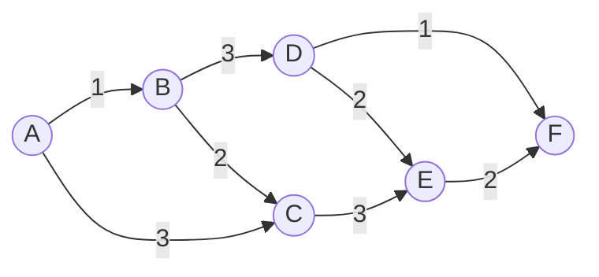

# Звіт з самостійної роботи №12

**Варіант:** №10

### Схема топології мережі (Варіант 10)

### Завдання 1. Пошук шляху за кількістю переходів (RIP)

У протоколі RIP вага кожного ребра приймається рівною $1$ ($w = 1$), а метрикою є кількість переходів (hop count).

* **Вихідний вузол:** A
* **Вузол призначення:** F
* **Можливі шляхи від A до F та їх довжина у переходах:**
  * $A \rightarrow B \rightarrow D \rightarrow F$ — $3$ переходи ($A \rightarrow B \rightarrow D \rightarrow F$)
  * $A \rightarrow C \rightarrow E \rightarrow F$ — $3$ переходи ($A \rightarrow C \rightarrow E \rightarrow F$)
  * $A \rightarrow B \rightarrow C \rightarrow E \rightarrow F$ — $4$ переходи
  * $A \rightarrow B \rightarrow D \rightarrow E \rightarrow F$ — $4$ переходи

* **Найкоротший шлях за кількістю переходів:** $A \rightarrow B \rightarrow D \rightarrow F$
* **Кількість переходів (Hop Count):** $3$

### Завдання 2. Пошук шляху за сумою ваг (OSPF, алгоритм Дейкстри)

У протоколі OSPF враховується вартість (вага) кожного каналу, яка обернено пропорційна його пропускній здатності. Для знаходження оптимального шляху застосовуємо алгоритм Дейкстри.

#### Покрокова таблиця роботи алгоритму Дейкстри:

| Крок | Оброблюваний вузол $u$ | $D(A)$ | $D(B)$ | $D(C)$ | $D(D)$ | $D(E)$ | $D(F)$ | Множина оброблених вузлів $S$ |
| :---: | :---: | :---: | :---: | :---: | :---: | :---: | :---: | :---: |
| **0** | Ініціалізація | $0$ | $\infty$ | $\infty$ | $\infty$ | $\infty$ | $\infty$ | $\emptyset$ |
| **1** | **A** ($d=0$) | $0$ | $1$ (від A) | $3$ (від A) | $\infty$ | $\infty$ | $\infty$ | $\{A\}$ |
| **2** | **B** ($d=1$) | $0$ | $1$ | $3$ (від A) | $4$ (від B) | $\infty$ | $\infty$ | $\{A, B\}$ |
| **3** | **C** ($d=3$) | $0$ | $1$ | $3$ | $4$ (від B) | $6$ (від C) | $\infty$ | $\{A, B, C\}$ |
| **4** | **D** ($d=4$) | $0$ | $1$ | $3$ | $4$ | $6$ (від C) | $5$ (від D) | $\{A, B, C, D\}$ |
| **5** | **F** ($d=5$) | $0$ | $1$ | $3$ | $4$ | $6$ (від C) | $5$ | $\{A, B, C, D, F\}$ |
| **6** | **E** ($d=6$) | $0$ | $1$ | $3$ | $4$ | $6$ | $5$ | $\{A, B, C, D, F, E\}$ |

* **Оптимальний шлях за вагою:** $A \rightarrow B \rightarrow D \rightarrow F$
* **Підсумкова вартість (Cost):** $1 + 3 + 1 = 5$

### Завдання 3. Порівняння та аналіз отриманих шляхів

У моєму варіанті маршрути, обрані за кількістю переходів (RIP) та за сумою ваг (OSPF), **збігаються** і проходять через послідовність вузлів $A \rightarrow B \rightarrow D \rightarrow F$. Такий збіг виникає у топологіях, де траєкторія з найменшою фізичною кількістю проміжних ребер (3 переходи) одночасно складається з високошвидкісних каналів з низькою сумарною вартістю ($1 + 3 + 1 = 5$). У цьому випадку найкоротший шлях за геометрією графa не містить «вузьких місць» (каналів з високою вагою), тому обидва протоколи обирають один і той самий маршрут.

### Завдання 4. Порівняльна характеристика протоколів та особливості BGP

#### Порівняльна таблиця RIP, OSPF, BGP:

| Критерій | RIP (v2) | OSPF | BGP (v4) |
| :--- | :--- | :--- | :--- |
| **Тип алгоритму** | Дистанційно-векторний (Distance Vector, Bellman-Ford) | Стану каналів (Link-State, Dijkstra) | Вектора шляху (Path Vector) |
| **Метрика** | Кількість переходів (Hop Count, макс. 15) | Вартість каналу (Cost $\sim 1/\text{bandwidth}$) | Вектор атрибутів (AS-Path, Local Preference, MED тощо) |
| **Область застосування** | Внутрішньодоменна (IGP), малі мережі | Внутрішньодоменна (IGP), великі корпоративні мережі | Міжавтономна (EGP), глобальний Інтернет |
| **Швидкість збіжності** | Низька (30 сек. періодичні оновлення) | Висока (миттєві LSA при змінах) | Повільна/поміркова (через масштаб та політики) |
| **Масштабованість** | Дуже низька (до 15 хопів) | Висока (ієрархічна структура через Area) | Надзвичайно висока (сотни тисяч маршрутів) |

#### Причини використання BGP для міжавтономної маршрутизації:
Маршрутизація між автономними системами (AS) потребує окремого протоколу BGP з двох ключових причин:
1. **Масштаб таблиці маршрутів:** Глобальний Інтернет містить понад 900 000 префіксів; протоколи OSPF чи RIP нездатні зберігати та прораховувати таку топологію через вибухове зростання навантаження на процесор та пам'ять.
2. **Договірні відносини та політики (Peering/Transit):** Вибір маршруту між провайдерами визначається не найкоротшою технічною відстанню, а економічними угодами (компесація за транзит, безкоштовний піринг), що вимагає на гнучких правил та атрибутів (AS-Path, Local Preference), які підтримує лише BGP.

### Відповіді на контрольні запитання

1. **Чому дистанційно-векторний протокол і протокол стану каналу можуть обрати різні маршрути для однієї пари вузлів?**  
   Дистанційно-векторні протоколи (RIP) розраховують шлях виключно за кількістю проміжних маршрутизаторів (hop count), вважаючи всі канали однаковими. Протоколи стану каналів (OSPF) враховують реальну пропускну здатність каналів. Якщо коротший за переходами шлях містить повільне з'єднання (наприклад, 56 кбіт/с), OSPF обере довший за переходами, але значно швидший шлях через оптоволоконні лінії.

2. **Опишіть один крок алгоритму Дейкстри своїми словами.**  
   На кожному кроці алгоритм обирає серед усіх ще не оброблених (непостійних) вузлів той, який має найменшу поточну розраховану відстань від джерела, фіксує цю відстань як остаточну (мітить вузол як оброблений), а потім перевіряє всіх його невідвіданих сусідів і при потребі зменшує значені для них відстані.

3. **Чим відрізняється область застосування OSPF від BGP?**  
   OSPF застосовується як внутрішній протокол маршрутизації (IGP) в межах однієї автономної системи або організації для швидкої технічної оптимізації трафіку. BGP є зовнішнім протоколом (EGP) і використовується для з'єднання різних автономних систем та провайдерів у глобальному Інтернеті.

4. **Чому вибір маршруту в BGP не зводиться лише до найкоротшої технічної відстані?**  
   У глобальній мережі вирішальними є комерційні та безпекові політики провайдерів. Провайдер може віддати перевагу дещо довшому маршруту, якщо він проходить через безкоштовний піринговий канал, аніж коротшому маршруту, за передачу трафіку яким доведеться платити сторонньому транзитному оператору.