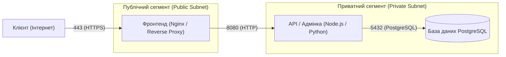

# Звіт з самостійної роботи №15

**Варіант:** №10

### Завдання 1. Мережева схема застосунку «Форум»

Згідно з вимогами варіанта 10, зовнішньому користувачеві доступний лише порт HTTPS (443) веб-фронтенду у публічному сегменті. Сервіс API з панеллю адміністрування та база даних повністю ізольовані у приватному сегменті.

### Завдання 2. Вибір режиму мережі контейнерів та виявлення сервісів (Service Discovery)

Для ізоляції та взаємодії контейнерів обрано режим користувацької мостової мережі (**User-defined Bridge Network** у Docker / ізольована мережа VPC у хмарі).

**Обґрунтування вибору:**
1. **Service Discovery за іменем:** У користувацькій bridge-мережі працює вбудований DNS-сервер Docker, що дозволяє сервісам звертатися один до одного за іменами контейнерів (наприклад, `http://api:8080` або `postgresql://db:5432`), без жорсткої прив'язки до динамічних IP-адрес.
2. **Чому не обрано режим `host`:** Режим `host` вимикає мережеву ізоляцію контейнера від хост-системи, що робить неможливим розмежування приватного та публічного сегментів та створює ризик конфлікту портів.
3. **Чому не обрано стандартний (default) `bridge`:** Стандартна мостова мережа не підтримує автоматичне виявлення сервісів за іменем через DNS (потрібні застарілі `--link`).

### Завдання 3. Таблиця груп безпеки (Security Groups / Firewall Rules)

Правила брандмауера розроблені за принципом мінімальних привілеїв (Least Privilege Access):

| Сервіс (Target) | Дозволений вхідний порт | Дозволене джерело (Allowed Source) | Призначення |
| :--- | :--- | :--- | :--- |
| **Фронтенд** | `443/TCP` (HTTPS) | `0.0.0.0/0` (Усі публічні користувачі) | Доступ користувачів до веб-інтерфейсу форуму |
| **API / Адмінка** | `8080/TCP` (HTTP) | Публічний сегмент / IP Фронтенду (`10.0.1.0/24`) | Прийом запитів лише від зворотного проксі (Фронтенду) |
| **База даних** | `5432/TCP` (PostgreSQL) | Приватний сегмент / IP API (`10.0.2.10`) | Доступ до даних виключно з боку backend-сервісу |

### Завдання 4. Метрики моніторингу та алгоритм діагностики недоступності

#### Перелік необхідних метрик (мінімум 4):
1. **Затримка відповіді (Response Latency / RTT):** Час обробки HTTP-запиту (p95 / p99 percentile).
2. **Частка помилок (Error Rate):** Відсоток відповідей з кодами `5xx` (Server Error) від загальної кількості запитів.
3. **Статус перевірки стану (Healthcheck Status):** Результати періодичних HTTP/TCP проб (liveness / readiness probes).
4. **Використання ресурсів (Resource Utilization):** Завантаження CPU, обсяг RAM, мережевий трафік (Network I/O) та дисків за контейнерами.

#### Порядок діагностики недоступності (3 кроки від найшвидшого до найглибшого):

1. **Крок 1: Перевірка мережевої зв'язності та healthcheck-ендпоінтів (Fast Check).**
   Виконання перевірки стану сервісів за допомогою HTTP-запиту (`curl -I https://forum.example.com/health`) та перевірка доступності внутрішніх портів через `nc -zv api 8080` чи `ping`.

2. **Крок 2: Аналіз логів застосунку та панелей метрик (Log & Dashboard Inspection).**
   Аналіз графіків у Grafana/Prometheus (сплески 500-х помилок, вичерпання CPU/RAM) та перегляд останніх системних логів контейнерів (`docker logs --tail 100 api` або `kubectl logs`).

3. **Крок 3: Глибока діагностика трафіку та стану середовища (Deep Diagnostics).**
   Аналіз мережевих маршрутів і правил фаєрволу, перевірка з'єднань з базою даних (`pg_isready`), інспекція стану контейнера (`docker inspect api`) та аналіз дампу мережевих пакетів (`tcpdump`).

### Відповіді на контрольні запитання

1. **Чому базі даних чи черзі повідомлень зазвичай не варто відкривати порт назовні?**
   Відкриття внутрішніх портів БД або черг повідомлень у публічну мережу створює критичну загрозу безпеці. Це наражає сервіси на атаки прямого підбору паролів (brute-force), експлуатацію вразливостей СУБД, несанкціонований витік або знищення даних та DDoS-атаки.

2. **Який режим мережі контейнерів підходить для сервісу без потреби в максимальній ізоляції, і чому це рідко виправданий вибір?**
   Для цього підходить режим **`host`**, при якому контейнер ділить мережевий стек безпосередньо з хост-системою. Це рідко виправдано, оскільки повністю втрачається мережева ізоляція, виникають конфлікти портів між контейнерами та підвищуються ризики безпеки при компрометації застосунку.

3. **Яку перевірку варто виконати першою при повідомленні «сервіс недоступний»?**
   Найперше слід виконати перевірку мережевої доступності та статусу Healthcheck (наприклад, перевірити HTTP-код відповіді ендпоінта healthcheck або виконати перевірку відгуку порту за допомогою `curl`/`nc`), щоб визначити, чи проблема в мережі/запуску контейнера, чи у внутрішній логіці застосунку.