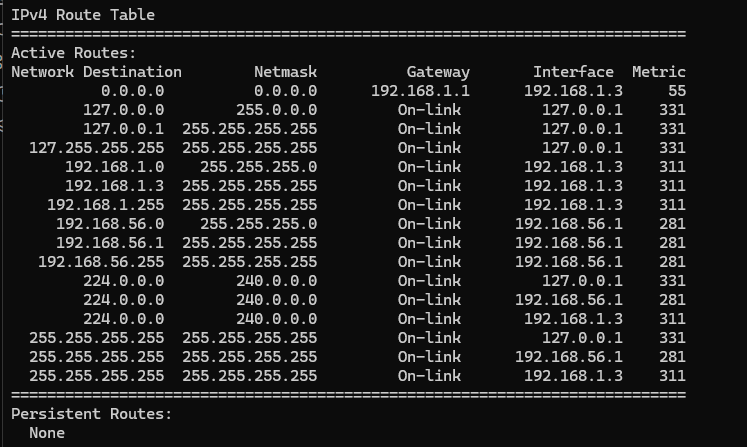

# Звіт з домашнього завдання до лекції №16

### Завдання 1. Вибір маршруту за правилом найдовшого збігу префікса (Longest Prefix Match)

1. **Аналіз відповідності IP-адреси `10.20.5.10` наявним записам:**
   * **`0.0.0.0/0` (Default Route):** Довжина префікса $0$ біт. Охоплює весь діапазон IPv4-адрес ($0.0.0.0 - 255.255.255.255$). Адреса `10.20.5.10` підпадає під цей запис.
   * **`10.0.0.0/8`:** Довжина префікса $8$ біт (маска `255.0.0.0`). Перевіряє перший октет (`10`). Охоплює діапазон від `10.0.0.0` до `10.255.255.255`. Адреса `10.20.5.10` підпадає під цей запис.
   * **`10.20.0.0/16`:** Довжина префікса $16$ біт (маска `255.255.0.0`). Перевіряє перші два октети (`10.20`). Охоплює діапазон від `10.20.0.0` до `10.20.255.255`. Адреса `10.20.5.10` підпадає під цей запис.
   * **`10.20.5.0/24`:** Довжина префікса $24$ біти (маска `255.255.255.0`). Перевіряє перші три октети (`10.20.5`). Охоплює діапазон від `10.20.5.0` до `10.20.5.255`. Адреса `10.20.5.10` підпадає під цей запис.

2. **Застосування правила найдовшого збігу префікса (Longest Prefix Match):**
   Пакет призначено для адреси `10.20.5.10`, яка одночасно підпадає під усі чотири записи таблиці маршрутизації. Згідно з базовим алгоритмом маршрутизатора, при наявності кількох маршрутів до однієї точки вибирається той запис, який має **найбільшу довжину префікса (найточнішу маску підмережі)**.

   Порівняємо довжину префіксів:
   $$24 \text{ біти } (/24) > 16 \text{ біт } (/16) > 8 \text{ біт } (/8) > 0 \text{ біт } (/0)$$

**Висновок:** Для пакета з адресою призначення `10.20.5.10` маршрутизатор обере запис **`10.20.5.0/24`**, оскільки маска `/24` є найдовшою серед усіх відповідних записів і найточніше описує цільову підмережу.

### Завдання 2. Перегляд та аналіз таблиці маршрутизації в ОС

**Команда виконання:** `route print`

#### Скріншот виконаної роботи:

#### Аналіз результатів виконання команди:

1. **Маршрут за замовчуванням (Default Route):**
   У виведеній таблиці маршрутизації знайдено запис з мережею призначення `0.0.0.0` та маскою `0.0.0.0` (`0.0.0.0/0`).
   * **Мережа призначення:** `0.0.0.0`
   * **Маска мережі:** `0.0.0.0` (префікс `/0`)
   * **Адреса шлюзу (Default Gateway):** `192.168.1.1`
   * **Мережевий інтерфейс:** `192.168.1.15`
   * **Метрика:** `35`

2. **Пояснення призначення шлюзу за замовчуванням:**
   Маршрут `0.0.0.0/0` використовується операційною системою для надсилання абсолютно всіх пакетів, адреса призначення яких відсутня у конкретніших записах локальної таблиці маршрутизації (тобто для всього інтерфейсного трафіку в мережу Інтернет).

## Відповіді на контрольні запитання

1. **Чим маршрутизатор принципово відрізняється від комутатора?**
   Маршрутизатор працює на мережевому рівні (Layer 3) і пересилає пакети між різними мережами на основі IP-адрес, розділяючи широкомовні домени. Комутатор працює на канальному рівні (Layer 2) і пересилає кадри всередині однієї мережі на основі MAC-адрес.

2. **Що таке правило найдовшого збігу префікса і навіщо воно потрібне?**
   Це правило, за яким при наявності декількох відповідних записів у таблиці маршрутизації обирається запис із найдовшою маскою підмережі (найбільшим префіксом), оскільки він найточніше описує адресат.

3. **Порівняйте RIP і OSPF за метрикою та швидкістю збіжності:**
   * **RIP:** Дистанційно-векторний протокол; метрика — кількість переходів (hop count, макс. 15); швидкість збіжності — повільна.
   * **OSPF:** Протокол стану каналу; метрика — вартість каналу (пропускна здатність); швидкість збіжності — швидка.

4. **Яку роль відіграє BGP на рівні глобального інтернету?**
   BGP є протоколом міждоменної маршрутизації (Path Vector), який зв'язує автономні системи (AS) в глобальному Інтернеті, враховуючи правила політик та комерційні угоди між провайдерами (peering, transit).

5. **У чому різниця між статичним NAT, динамічним NAT і PAT?**
   * **Статичний NAT:** Постійне відношення $1:1$ (одна приватна IP $\leftrightarrow$ одна публічна IP).
   * **Динамічний NAT:** Динамічна відповідність приватних IP до пулу публічних IP.
   * **PAT (Port Address Translation / Overload):** Багато приватних IP відображаються на єдину публічну IP за рахунок використання унікальних номерів портів.

6. **Чому вхідне з'єднання до вузла за NAT потребує пробросу порту (Port Forwarding)?**
   Тому що трансляції в PAT створюються лише при вихідному запиті зсередини. Для невідомого вхідного пакета ззовні в таблиці NAT немає запису, і роутер скидає його. Проброс порту явно вказує, куди перенаправляти такі вхідні пакети.

7. **Чому статичний маршрут не реагує на обрив каналу, а динамічний реагує?**
   Статичний маршрут прописується вручну і залишається в таблиці до вилучення адміністратором. Динамічні протоколи обмінюються службовими пакетами i при втраті зв'язку автоматично перераховують та оновлюють таблицю.

8. **Чому в прикладі з розділу 4 RIP і OSPF обрали різні шляхи від A до E?**
   RIP обрав шлях $A-C-E$ (2 переходи), бо бачить лише кількість хопів. OSPF обрав шлях $A-B-C-D-E$ (загальна вартість 6 проти 11 у $A-C-E$), врахувавши високу пропускну здатність каналів.

9. **Які поля показує команда `show ip nat translations` і що означає кожне з них?**
   * **Inside local:** Приватна IP-адреса та порт внутрішнього вузла.
   * **Inside global:** Публічна IP-адреса та порт, які бачить зовнішня мережа.
   * **Outside local:** IP-адреса та порт зовнішнього пристрою, як їх бачить внутрішня мережа.
   * **Outside global:** Реальна публічна IP-адреса та порт зовнішнього пристрою.
