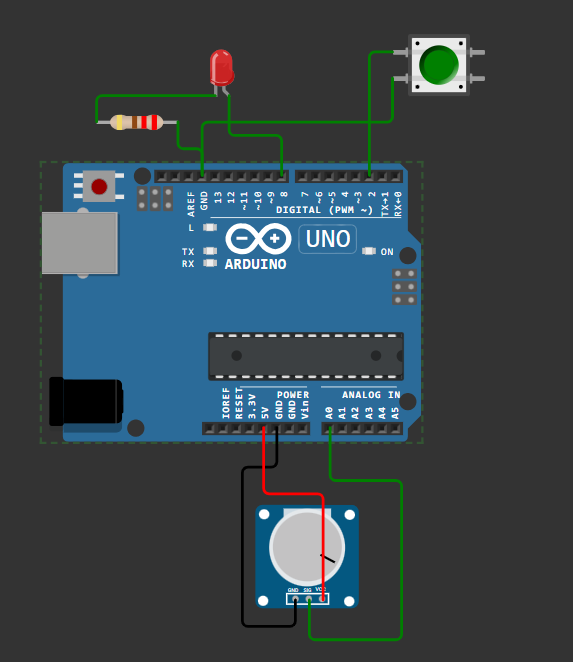

# Практична робота №6

**Варіант:** №10

## Схема підключення компонентів у Wokwi



## Вихідний код C++

```cpp
const int BUTTON_PIN = 2;
const int LED_PIN = 8;
const int SENSOR_PIN = A0;

bool ledState = false;
bool lastButtonState = HIGH;

unsigned long lastMeasurement = 0;
const unsigned long INTERVAL = 1000;

int currentMin = 1023;
int currentMax = 0;

void setup() {
  pinMode(BUTTON_PIN, INPUT_PULLUP);
  pinMode(LED_PIN, OUTPUT);
  digitalWrite(LED_PIN, ledState);

  Serial.begin(9600);
}

void loop() {
  bool buttonState = digitalRead(BUTTON_PIN);
  
  if (buttonState == LOW && lastButtonState == HIGH) {
    ledState = !ledState;
    digitalWrite(LED_PIN, ledState);
    delay(50);
  }
  lastButtonState = buttonState;

  int rawValue = analogRead(SENSOR_PIN);
  int distance = map(rawValue, 0, 1023, 10, 200);

  if (distance < currentMin) currentMin = distance;
  if (distance > currentMax) currentMax = distance;

  unsigned long now = millis();
  if (now - lastMeasurement >= INTERVAL) {
    lastMeasurement = now;

    Serial.print("dist=");
    Serial.print(distance);
    Serial.print(";min=");
    Serial.print(currentMin);
    Serial.print(";max=");
    Serial.println(currentMax);

    currentMin = distance;
    currentMax = distance;
  }
}
```

## Приклад виводу у Serial Monitor (UART)

```text
dist=10;min=10;max=10
dist=10;min=10;max=10
dist=10;min=10;max=10
dist=37;min=10;max=37
dist=108;min=37;max=108
dist=108;min=108;max=108
dist=140;min=108;max=140
```

## Домашнє завдання

### 1. Пояснення роботи `delay()` проти `millis()`

* **Чому `delay()` є проблемним підходом:**  
  Функція `delay(1000)` повністю зупиняє виконання мікроконтролера на 1000 мілісекунд. Процесор у цей час перебуває в холостому циклі очікування і не може опитувати стан вхідних пінів. Якби в нашому скетчі був використаний `delay(1000)`, кнопка відповідала б із затримкою до 1 секунди або пропускала б натискання взагалі.
* **Перевага `millis()`:**  
  Підхід на основі `millis()` створює асинхронний таймер. Програма виконується беззупиново, миттєво реагуючи на натискання кнопки у кожному циклі `loop()`, і лише раз на 1000 мс виконує блок передачі даних через UART.

### 2. Значення вибору роздільників у форматованому повідомленні

Символи-роздільники (наприклад, `;` та `=`) дозволяють програмним парсерам на приймальній стороні (наприклад, серверу на Python/C# у Практичній №10) легко розділити вхідний рядок на окремі ключі й значення за допомогою алгоритму string split, усуваючи неоднозначність при автоматичній обробці мережевих пакетів.

### 3. Розрахунки АЦП та ШІМ

1. **Розрахунок значення 10-бітного АЦП ($V_{\text{ref}} = 5\text{ В}$, $V_{\text{in}} = 3.3\text{ В}$):**
   $$\text{ADC\_Value} = \text{round}\left( \frac{V_{\text{in}}}{V_{\text{ref}}} \times 1023 \right) = \text{round}\left( \frac{3.3}{5.0} \times 1023 \right) = \text{round}(675.18) = 675$$

2. **Шпаруватість ШІМ (\%) та значення для `analogWrite()` ($V_{\text{out}} = 3.3\text{ В}$):**
   $$\text{Duty\_Cycle} = \frac{V_{\text{out}}}{V_{\text{ref}}} \times 100\% = \frac{3.3}{5.0} \times 100\% = 66\%$$
   $$\text{PWM\_Value} = \text{round}\left( \frac{V_{\text{out}}}{V_{\text{ref}}} \times 255 \right) = \text{round}\left( \frac{3.3}{5.0} \times 255 \right) = \text{round}(168.3) = 168$$

## Відповіді на контрольні запитання

1. **Для чого призначений режим `INPUT_PULLUP`?**  
   Режим `INPUT_PULLUP` вмикає внутрішній підтягувальний резистор Arduino (близько 20–50 кОм) до лінії +5V. Це дозволяє підключати кнопку без зовнішнього резистора безпосередньо між піном та GND.

2. **Яку розрядність має АЦП Arduino Uno і в якому діапазоні значень повертає `analogRead()`?**  
   АЦП має розрядність **10 біт**, функція `analogRead()` повертає цілі числа від **0 до 1023** (де 0 відповідає 0 В, а 1023 відповідає $V_{\text{ref}} = 5\text{ В}$).

3. **Чому використання `delay()` у циклі вважається проблемним підходом?**  
   Тому що `delay()` зупиняє потік виконання процесора, блокуючи виконання інших задач (опитування датчиків, обробка кнопок, прийом даних по UART).

4. **Чому формат повідомлення через UART важливо продумати заздалегідь?**  
   Продуманий текстовий або бінарний формат забезпечує однозначність розбору даних (parsing) мережевими протоколами і серверами без втрати контексту чи викривлення значень.

5. **У чому полягає відмінність між синхронним та асинхронним послідовними інтерфейсами?**  
   Синхронний інтерфейс (SPI, I2C) використовує окрему спільну лінію тактування (Clock) для синхронізації передачі бітів. Асинхронний інтерфейс (UART) не має лінії тактування; сторони заздалегідь домовляються про однакову швидкість передачі (Baud rate) та використовують старт/стоп біти.

## Висновки

У ході виконання практичної роботи було повністю реалізовано мікроконтролерний вузол на базі Arduino Uno. Використання режимів `INPUT_PULLUP` та обробка за допомогою `millis()` дозволили створити чутливу неблокувальну програму, яка одночасно керує світлодіодом та опитує аналоговий датчик. Згенерований формат рядка UART повністю відповідає вимогам Варіанта 10 і готовий для подальшого використання у мережевих завданнях.